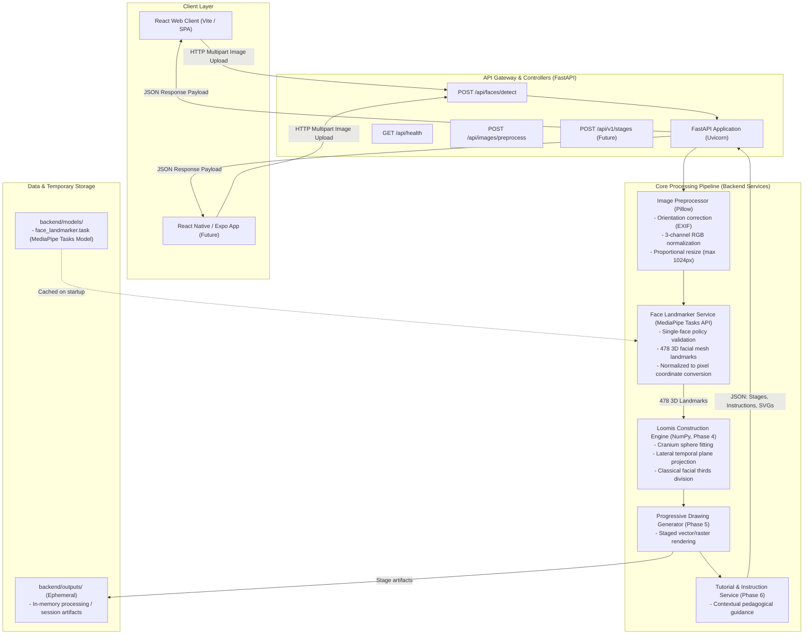

# Loomis AI – System Architecture

## 1. Overview

Loomis AI utilizes a decoupled client-server architecture designed to balance computational performance, modularity, and cross-platform flexibility. The compute-intensive computer vision pipeline, 3D geometric projections, and stage rendering execute on a Python/FastAPI backend, while client applications (React Web and future React Native Mobile) provide responsive, interactive tutorial interfaces.

---

## 2. High-Level Architecture Diagram



---

## 3. Component Details & Interactions

### 3.1 Client Layer
- **React Web Client**: Built with React and modern client-side state management. Features an interactive drawing stepper, reference image opacity slider, guideline layer toggles, and drawing canvas.
- **React Native / Expo Mobile App**: Planned for Phase 9 to deliver an optimized touch and tablet experience (iPad / Android tablets) for physical styluses (Apple Pencil / S-Pen).
- **Communication Protocol**: Standard RESTful JSON over HTTPS, with multipart form data for image upload and Base64/SVG responses.

### 3.2 API Layer (FastAPI)
- **FastAPI Framework**: High-throughput asynchronous request handling, OpenAPI documentation (Swagger UI / ReDoc), and strict Pydantic validation.
- **Startup Lifecycle Management (`lifespan`)**: Preloads the MediaPipe Face Landmarker model on application boot, eliminating cold-start latency on subsequent requests.
- **Exception Handlers**: Centralized handlers mapping domain errors (`ImageValidationError`, `FaceDetectionError`) into standardized HTTP error payloads.

### 3.3 Core Processing Pipeline

1. **Image Preprocessing Service (`image_processor.py`, `image_validator.py`)**:
   - Ingests raw uploaded bytes in memory without disk persistence.
   - Enforces 10 MB payload limits and 8192px maximum dimension limits.
   - Content-based verification (inspects binary headers via Pillow, rejecting disguised or corrupted files).
   - Auto-rotates orientation using EXIF tags (`ImageOps.exif_transpose`).
   - Normalizes color channels to 3-channel RGB (compositing alpha transparency cleanly over white).
   - Proportionally resizes images whose longest edge exceeds 1024px using Lanczos resampling (preventing facial distortion).

2. **Face Detection & Landmark Extraction (`face_detector.py`)** *(Implemented in Phase 2)*:
   - Uses the official **MediaPipe Face Landmarker Tasks API** in `IMAGE` running mode.
   - Loads the official `face_landmarker.task` model with thread-safe cached inference (`threading.Lock()`).
   - Enforces the **Single-Face Policy**: detects up to 3 faces to verify presence; rejects images with 0 faces or multiple faces with clear, actionable user errors.
   - Extracts all **478 dense 3D facial landmarks** (x, y, z normalized coordinates) in canonical order without arbitrary pruning.
   - Converts normalized coordinates $[0.0, 1.0]$ into pixel coordinates using processed image dimensions:
     $$\text{pixel\_x} = \text{round}(x \times \text{width}, 2), \quad \text{pixel\_y} = \text{round}(y \times \text{height}, 2)$$

3. **Loomis Construction Engine (`LoomisEngine`)** *(Phase 4)*:
   - Takes the 478 empirical landmarks and head rotation matrix.
   - **Cranium Sphere**: Calculates 3D center $(x_c, y_c, z_c)$ and radius $R$ by fitting a sphere to cranial anchor points.
   - **Lateral Cut Planes**: Calculates temporal disc ellipses based on head yaw and pitch.
   - **Facial Thirds**: Computes central meridian, brow line equator, hairline, and nose base line.
   - **Jaw Cradle**: Links temporal discs to chin contour.

4. **Progressive Drawing Generator (`DrawingGenerator`)** *(Phase 5)*:
   - Progressively generates drawing stages from initial sphere to final facial outlines.

5. **Tutorial & Instruction Service (`TutorialEngine`)** *(Phase 6)*:
   - Generates contextual pedagogical advice customized to the subject's pose.

---

## 4. Implemented API Contracts

### 4.1 Health Check
- **Route**: `GET /api/health`
- **Response**: `200 OK`
```json
{
  "status": "healthy",
  "service": "loomis-ai-backend",
  "version": "0.2.0"
}
```

### 4.2 Image Preprocessing
- **Route**: `POST /api/images/preprocess`
- **Request**: `multipart/form-data` with `file`
- **Response**: `200 OK`
```json
{
  "success": true,
  "message": "Image preprocessed successfully.",
  "original_width": 2048,
  "original_height": 1536,
  "processed_width": 1024,
  "processed_height": 768,
  "original_format": "JPEG",
  "processed_format": "JPEG",
  "image_base64": "/9j/4AAQSkZJRgABAQ...",
  "processing_status": "success"
}
```

### 4.3 Face Detection & Landmark Extraction
- **Route**: `POST /api/faces/detect`
- **Request**: `multipart/form-data` with `file` (JPEG, PNG, WebP up to 10 MB)
- **Response**: `200 OK`
```json
{
  "success": true,
  "message": "Face detected and landmarks extracted successfully.",
  "image_width": 1024,
  "image_height": 768,
  "faces_detected": 1,
  "landmarks": [
    {
      "index": 0,
      "x": 0.506726,
      "y": 0.601664,
      "z": -0.065996,
      "pixel_x": 518.89,
      "pixel_y": 462.08
    }
  ]
}
```
- **Error Responses**:
  - `400 Bad Request`: Empty file, corrupted image, no face detected, or multiple faces detected.
  - `413 Content Too Large`: File exceeds 10 MB limit.
  - `415 Unsupported Media Type`: Unsupported format (e.g. GIF).
  - `503 Service Unavailable`: Face landmarker model file not found or failed to load.
