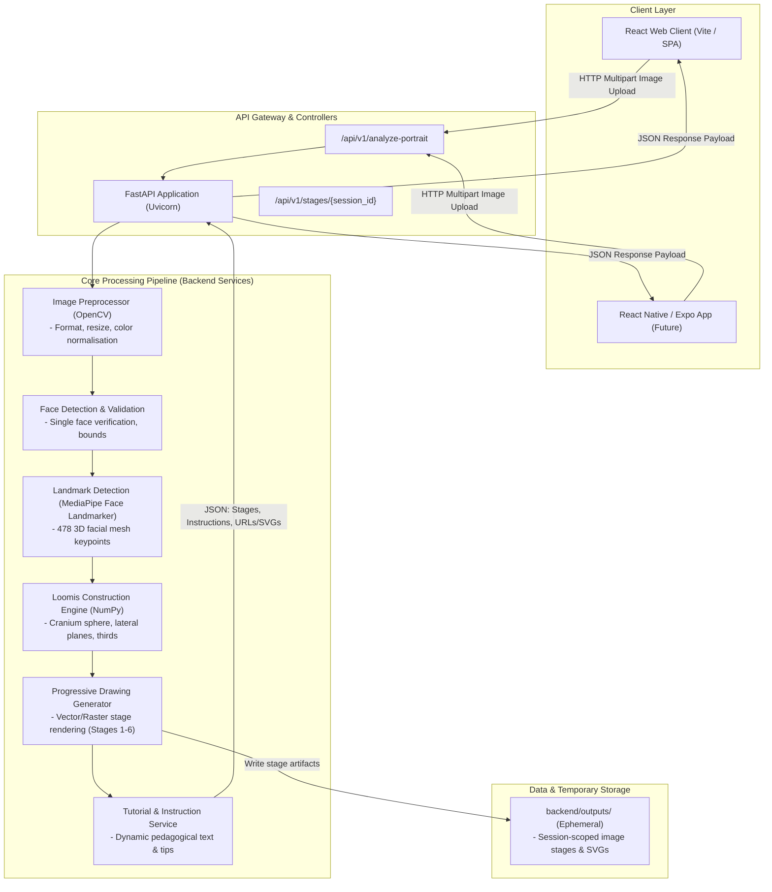

# Loomis AI – System Architecture

## 1. Overview

Loomis AI utilizes a decoupled client-server architecture designed to balance computational performance, modularity, and cross-platform flexibility. The compute-intensive computer vision pipeline, 3D geometric projections, and stage rendering execute on a Python/FastAPI backend, while client applications (React Web and future React Native Mobile) provide responsive, interactive tutorial interfaces.

---

## 2. High-Level Architecture Diagram



---

## 3. Component Details & Interactions

### 3.1 Client Layer
- **React Web Client**: Built with React and modern client-side state management. Features an interactive drawing stepper, reference image opacity slider, guideline layer toggles, and drawing canvas.
- **React Native / Expo Mobile App**: Planned for Phase 9 to deliver an optimized touch and tablet experience (iPad / Android tablets) for physical styluses (Apple Pencil / S-Pen).
- **Communication Protocol**: Standard RESTful JSON over HTTPS, with multipart form data for initial image upload and Base64/SVG or static asset URLs for stage deliveries.

### 3.2 API Layer (FastAPI)
- **FastAPI Framework**: Provides high-throughput, asynchronous request handling, OpenAPI documentation, and strict schema validation via Pydantic models.
- **Session Management**: Issues ephemeral session IDs to associate an uploaded portrait with its computed geometric coordinates and generated drawing stages.

### 3.3 Core Processing Pipeline

1. **Image Preprocessor (`PreprocessService`)**:
   - Ingests raw uploaded bytes.
   - Decodes image via OpenCV (`cv2.imdecode`).
   - Normalizes orientation (EXIF rotation correction), validates color channels (RGB conversion), and resizes to an optimal processing resolution (e.g., standardizing long edge to 1024px) for consistent landmark precision.

2. **Face Detection & Validation (`FaceDetector`)**:
   - Verifies that exactly one human face is present in the frame.
   - Computes face bounding box and checks quality constraints (minimum face resolution, non-occlusion).
   - Rejects unsuitable images early with helpful human-readable guidance.

3. **Facial Landmark & Pose Extraction (`LandmarkService`)**:
   - Executes MediaPipe Face Landmarker on the preprocessed image.
   - Extracts 478 3D landmarks (x, y, z relative coordinates).
   - Derives head orientation angles: **Pitch** (up/down nod), **Yaw** (left/right turn), and **Roll** (lateral tilt).

4. **Loomis Construction Engine (`LoomisEngine`)**:
   - Bridges empirical landmarks and Loomis geometric theory.
   - **Cranium Sphere**: Calculates center point \((x_c, y_c, z_c)\) and radius \(R\) by fitting a 3D sphere to cranial anchor points (forehead, temples, parietal ridge).
   - **Lateral Cut Planes**: Calculates the temporal disc ellipses on the sides of the head based on head yaw and pitch, computing the flattened circular cross-sections.
   - **Facial Grid & Thirds**: Computes the central vertical axis, brow line, hairline, nose base line, and chin line based on Loomis proportions anchored to true landmarks.
   - **Jaw Cradle**: Extrapolates jawline angles and chin box geometry linking the temporal discs to the gnathion (chin tip).

5. **Progressive Drawing Generator (`DrawingGenerator`)**:
   - Renders 6 distinct visual stages progressively:
     - *Stage 1*: Cranium Sphere + Tilt Axis
     - *Stage 2*: Side Flattening Discs + Crosshairs
     - *Stage 3*: Facial Thirds Grid + Centerline
     - *Stage 4*: Jaw Plane & Chin Box
     - *Stage 5*: Feature Guides (Eyebrow arcs, eye sockets, nose wedge, mouth axis, ear bounding box)
     - *Stage 6*: Structural Contours and Refined Facial Profile
   - Produces clean vector overlays (SVG) and raster previews (PNG).

6. **Tutorial & Instruction Service (`TutorialEngine`)**:
   - Assembles contextual instructions for each stage based on the specific angle detected (e.g., *"Notice how in this 3/4 view, the side plane ellipse is clearly visible on the subject's left side"*).
   - Bundles stage metadata, visual URLs/paths, and drawing advice into a structured response payload.

### 3.4 Data & Storage Architecture
- **Stateless & Ephemeral**: Uploaded images and rendered tutorial steps are stored strictly in temporary, session-scoped directories (`backend/outputs/`) with automated time-to-live (TTL) expiration.
- **Privacy Assurance**: No user images, biometric templates, or derived identity parameters are persisted permanently or exposed publicly.

---

## 4. API Request / Response Contract (Planned)

### Endpoint: `POST /api/v1/analyze-portrait`
- **Request**: `multipart/form-data` containing:
  - `file`: Image file (JPEG, PNG, WebP)
  - `options`: Optional JSON string (e.g., target stage count, render style)
- **Response**: `application/json`
```json
{
  "session_id": "9b1deb4d-3b7d-4bad-9bdd-2b0d7b3dcb6d",
  "status": "success",
  "meta": {
    "image_width": 1024,
    "image_height": 1024,
    "pose": {
      "pitch": -4.2,
      "yaw": 28.5,
      "roll": 1.1,
      "classification": "three_quarters_left"
    }
  },
  "stages": [
    {
      "stage_number": 1,
      "title": "Cranium Sphere & Tilt Axis",
      "instruction": "Begin by lightly sketching a ball for the cranium. Notice the slight tilt along the central axis.",
      "image_url": "/api/v1/outputs/9b1deb4d/stage_1.png",
      "vector_svg": "<svg ...>...</svg>"
    }
  ]
}
```

